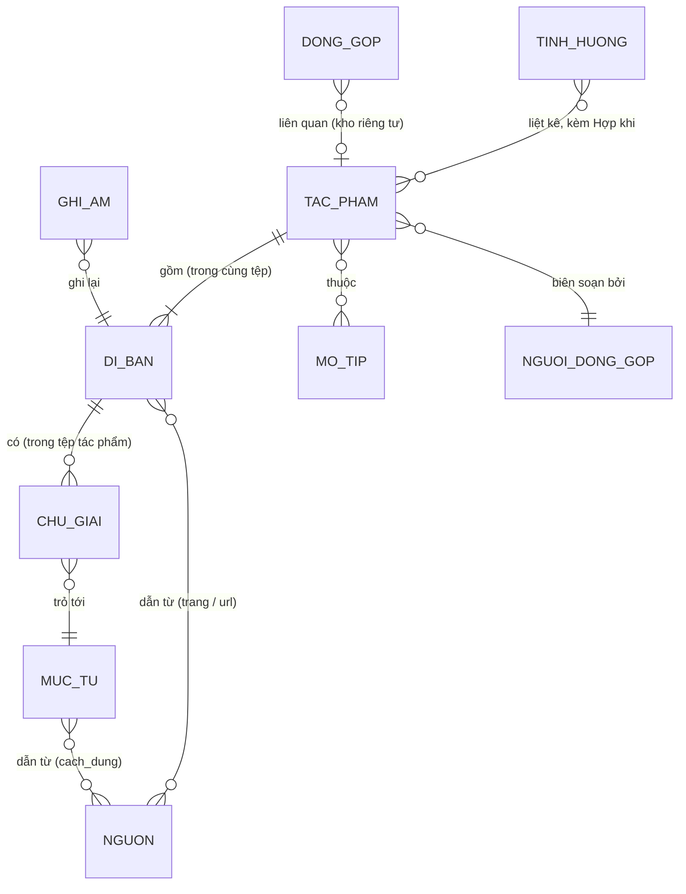

# 10 · Đặc tả dữ liệu

| | |
|---|---|
| Phiên bản schema | **2.0** · 23/10/2026 (hướng v2: D-040..D-046) |
| Trạng thái | **Ổn định.** Không còn "đóng băng" một lần (D-044); đổi khi hồ sơ thật cần, theo mục 12 |
| Thực thi bởi | `scripts/kiem-tra-du-lieu.mjs` (quy tắc R01–R22) · `scripts/lib/suy-ra.mjs` (dữ liệu suy ra) · `scripts/lib/neo-chu-giai.mjs` · `taxonomy/tu-vung-kiem-soat.yaml` · `templates/*.yaml` |
| Đọc khi | Biên soạn, viết mã đọc dữ liệu, viết công cụ, sửa schema |

Tài liệu này và `scripts/kiem-tra-du-lieu.mjs` phải luôn khớp nhau. Đổi một bên thì đổi bên kia trong cùng một commit, kèm fixture trong `tests/fixtures/`.

**Thay đổi chính so với 1.1:** bỏ `xac_thuc` nhập tay ở dị bản và ghi âm (nhãn do máy tính, D-041); trạng thái `nhap`/`cong_khai`/`an`; bỏ `ngay_kiem_dinh`; thêm `nhap_ai_da_duyet` (D-042); tham chiếu nguồn thêm `url`, `ngay_truy_cap`, `ban_luu_tru`, `cach_dung` (D-046); quy tắc hai tầng LỖI/NHẮC, thêm R20–R22 (D-043).

---

## 1. Sáu nguyên tắc mô hình hóa

1. **Tách Tác phẩm khỏi Dị bản.** Tác phẩm là đơn vị khái niệm; dị bản là một văn bản cụ thể có nguồn gốc. Mỗi tác phẩm có ≥ 1 dị bản và đúng một **bản đại diện** (giao diện gọi là "Bản tham chiếu").
2. **Chú giải là con trỏ.** "Từ này, ở dòng này, của dị bản này → mục từ X". Giải nghĩa viết một lần trong Từ điển dùng chung.
3. **Mọi câu có nguồn gốc; mọi khẳng định nói rõ mức kiểm.** Áp dụng cho lời, giải nghĩa, cách hiểu, âm thanh.
4. **Một sự thật, một nơi lưu.** Cái gì suy ra được lúc build thì không lưu (nhãn bằng chứng, dị bản được hiện, danh sách bài theo mô-típ, tình huống của một tác phẩm).
5. **Có tầng ngôn ngữ đời thường.** `mo_ta_tinh_huong` và "Hợp khi…" viết như người thường nói, phục vụ tìm kiếm và nhóm người trẻ.
6. **Người khai thứ dễ nhớ, máy suy ra phần còn lại.** Khi máy không chắc, máy báo lỗi để người chỉ rõ, không tự đoán.

## 2. Sơ đồ thực thể



## 3. Thư mục và quy ước mã

```text
content/                 (CÔNG KHAI — kể cả bài nháp; kho thô thu thập từ web KHÔNG nằm ở đây, D-045)
├── tac-pham/        cd-0142.yaml, tn-0007.yaml …   (dị bản và chú giải nằm TRONG tệp tác phẩm)
├── muc-tu/          lx-thai-son.yaml …
├── mo-tip/          mt-than-em-nhu.yaml …
├── nguon/           src-ca-dao-me.yaml, src-kho-tang-ca-dao-nguoi-viet.yaml …
├── tinh-huong/      sit-nho-me.yaml …
├── ghi-am/          au-0001.yaml …                   (chỉ siêu dữ liệu)
└── nguoi-dong-gop/  ctb-0001.yaml …                  (chỉ tên hiển thị)
redirects.yaml       slug cũ → slug mới
```

| Loại | Mã | Ví dụ | Ghi chú |
|---|---|---|---|
| Ca dao | `cd-####` | `cd-0142` | Tiền tố phải khớp `the_loai` |
| Tục ngữ | `tn-####` | `tn-0007` | |
| Thành ngữ | `tng-####` | `tng-0015` | |
| Đồng dao | `dd-####` | `dd-0003` | |
| Vè | `ve-####` | `ve-0001` | |
| Câu đố | `cdo-####` | `cdo-0001` | |
| Mục từ | `lx-<slug>` | `lx-thai-son` | |
| Mô-típ | `mt-<slug>` | `mt-than-em-nhu` | |
| Nguồn | `src-<slug>` | `src-ca-dao-me` | |
| Tình huống | `sit-<slug>` | `sit-nho-me` | |
| Ghi âm | `au-####` | `au-0088` | |
| Người đóng góp | `ctb-####` | `ctb-0012` | |
| Đóng góp (riêng tư) | `sub-YYYY-####` | `sub-2026-0031` | Không nằm trong kho mã |

**Quy tắc:**
- `id` trùng tên tệp. Bất biến; không đổi, không tái sử dụng. Số thứ tự không mang nghĩa.
- `slug`: bỏ dấu, chữ thường, nối gạch ngang, ≤ 60 ký tự, duy nhất trong tác phẩm. Trùng thì thêm `-2`. Đổi slug thì thêm dòng vào `redirects.yaml`.
- Ngày viết dạng `"YYYY-MM-DD"` trong ngoặc kép.

## 4. Đặc tả trường

Ký hiệu cột Bắt buộc: **✔** luôn bắt buộc (thiếu là LỖI R02) · **CK** nên có khi `cong_khai` (thiếu là NHẮC R10, không chặn) · trống = không bắt buộc.

### 4.1. Tác phẩm (`content/tac-pham/<id>.yaml`)

| Trường | Kiểu | Bắt buộc | Ràng buộc / mô tả |
|---|---|---|---|
| `id` | chuỗi | ✔ | Mục 3 |
| `slug` | chuỗi | ✔ | Mục 3 |
| `the_loai` | mã | ✔ | Từ vựng `the_loai` |
| `the_tho` | mã | CK nếu ca dao | Từ vựng `the_tho` |
| `tieu_de` | chuỗi | ✔ | Thường là dòng đầu của bản đại diện |
| `ban_dai_dien` | id dị bản | ✔ | Phải là dị bản có trong tệp (R05). Bài công khai: dị bản này phải có nguồn gốc (R21) |
| `ly_do_chon` | chuỗi | CK | Một câu: vì sao chọn bản này |
| `di_ban` | danh sách | ✔ (≥ 1) | Mục 4.2 |
| `chu_giai` | danh sách | | Mục 4.3 |
| `nghia_ngan` | chuỗi | CK | ≤ 40 từ (nên ≤ 25); dùng cho "Hiểu trong 10 giây", kết quả tìm, mô tả SEO |
| `dien_giai` | danh sách | CK (≥ 1) | Mỗi mục: `goc_nhin` ✔, `noi_dung` ✔ (Markdown), `nguon` (CK ≥ 1; R20 nếu chép nguyên văn) |
| `nghia_den` | chuỗi | CK nếu tục ngữ | |
| `nghia_bong` | chuỗi | | Tục ngữ có nghĩa bóng thì điền |
| `linh_vuc` | danh sách mã | CK nếu tục ngữ (≥ 1) | Từ vựng `linh_vuc` |
| `goc_kiem_chung` | đối tượng | | Tục ngữ kinh nghiệm: `ket_luan` ✔ (từ vựng `ket_luan_kiem_chung`), `noi_dung`, `nguon` |
| `am_luat` | đối tượng | | `nhip`, `van` (danh sách), `ghi_chu`. Chỉ điền khi người biên soạn tự kiểm |
| `dien_xuong` | đối tượng | | `hinh_thuc` (danh sách mã `hinh_thuc_dien_xuong`), `nguoi_the_hien`, `boi_canh`. Không rõ thì `khong_ro`, không bịa |
| `mo_ta_tinh_huong` | danh sách chuỗi | CK (≥ 2) | Câu đời thường, ngôi thứ hai |
| `cam_xuc` | danh sách mã | | ≤ 5; từ vựng `cam_xuc` |
| `chu_de` | danh sách mã | CK (≥ 1) | ≤ 3; từ vựng `chu_de` |
| `mo_tip` | danh sách id | | Trỏ `mo-tip/` |
| `lien_quan` | danh sách id | | Trỏ `tac-pham/`; người biên soạn chọn, không tự động |
| `sgk` | danh sách | | Mỗi mục: `bo_sach` ✔ (từ vựng `sgk_bo_sach`), `lop` ✔ (1–12), `bai` |
| `canh_bao_noi_dung` | chuỗi | | Bài phản ánh định kiến xưa: giải thích bối cảnh. Không gắn vào tình huống (R11) |
| `xac_thuc_dan_gian` | mã | | Mặc định `binh_thuong`; khác thì cần căn cứ (R13) |
| `can_cu_xac_thuc_dan_gian` | chuỗi | khi cờ ≠ `binh_thuong` | Căn cứ cụ thể: tác giả, lần xuất hiện đầu… |
| `tranh_luan` | đúng/sai | | Mặc định `false` |
| `ghi_chu_tranh_luan` | chuỗi | khi `tranh_luan: true` | Điều gì đang được bàn, các bên dẫn nguồn nào |
| `nhap_ai_da_duyet` | đúng/sai | | **Chỉ người biên soạn** đặt `true`, sau khi đã đọc và đồng ý mọi chuỗi `NHAP_AI` trong tệp (D-042) |
| `trang_thai` | mã | ✔ | `nhap` · `cong_khai` · `an` |
| `bien_soan` | đối tượng | ✔ | `nguoi` ✔ (ctb-…), `ngay_tao` ✔. "Cập nhật lần cuối" lấy từ lịch sử Git, không lưu |

**Không có** trường `xac_thuc` và `tinh_huong` ở cấp tác phẩm (D-007, D-010). Trường lạ bị từ chối (R16).

### 4.2. Dị bản (phần tử của `di_ban`)

| Trường | Kiểu | Bắt buộc | Ràng buộc / mô tả |
|---|---|---|---|
| `id` | chuỗi | ✔ | `v1`, `v2`… duy nhất trong tác phẩm |
| `loi` | chuỗi nhiều dòng | ✔ | Một dòng thơ một dòng văn bản; NFC; không khoảng trắng thừa đầu/cuối dòng; **giữ đúng như nguồn**; không bao giờ mang `NHAP_AI` (R09) |
| `vung` | danh sách mã | ✔ (≥ 1) | Từ vựng `vung`; chưa biết thì `khong_ro` |
| `dia_danh` | chuỗi | | Đúng như người kể / nguồn gọi, kể cả tên cũ |
| `nguon` | danh sách | ✔ (có thể rỗng khi nháp) | Mục 4.2a |
| `nguoi_ke` | đối tượng | | `the_he` ("sinh khoảng 1940"), `quan_he` ("bà nội người đóng góp"). Không tên thật |
| `dong_gop` | chuỗi | | `sub-YYYY-####` (cho nhãn C) |
| `ghi_chu` | chuỗi | | |

**Không có** trường `xac_thuc`: nhãn do máy tính (mục 5). Tệp cũ còn trường này bị R16 báo lỗi.

### 4.2a. Tham chiếu nguồn (dùng ở `di_ban[].nguon`, `dien_giai[].nguon`, `muc-tu.nguon`, `mo-tip.nguon`, `goc_kiem_chung.nguon`)

| Trường | Kiểu | Bắt buộc | Mô tả |
|---|---|---|---|
| `ref` | id | ✔ | `src-…` |
| `trang` | chuỗi | | Số trang — với sách, tạp chí, luận văn, bản quét |
| `url` | chuỗi | ✔ khi nguồn `web` (R22) | Địa chỉ của **đúng trang** đã lấy (không phải trang chủ) |
| `ngay_truy_cap` | ngày | ✔ khi nguồn `web` (R22) | |
| `ban_luu_tru` | chuỗi | CK với lời của bài công khai (NHẮC R22) | Bản lưu Wayback Machine của trang đó |
| `cach_dung` | mã | | Chỉ cho chú thích / diễn giải: `tham_khao` (đã viết lại) · `trich_nguyen_van` (R20). Chỉ người biên soạn đặt `trich_nguyen_van` |
| `ghi_chu` | chuỗi | | |

### 4.3. Chú giải (phần tử của `chu_giai`)

| Trường | Kiểu | Bắt buộc | Mô tả |
|---|---|---|---|
| `di_ban` | id | ✔ | Dị bản chứa cụm từ |
| `cum_tu` | chuỗi | ✔ | Gõ đúng như trong lời (không phân biệt hoa thường, bỏ qua dấu câu dính kèm) |
| `dong` | số nguyên | chỉ khi cần | Khai khi cụm từ xuất hiện ở nhiều dòng |
| `lan` | số nguyên | chỉ khi cần | Khai khi cụm từ vẫn lặp trong phạm vi đã chọn (cả dị bản, hoặc dòng `dong`) |
| `muc_tu` | id | ✔ | lx-… |
| `nghia_tai_cho` | chuỗi | | ≤ 40 từ; nghĩa riêng trong bài này nếu khác nghĩa chung |

**Cách khai thường gặp:** `{ di_ban: v1, cum_tu: "Thái Sơn", muc_tu: lx-thai-son }` — không cần đếm dòng hay âm tiết.

**Máy phân giải** (`scripts/lib/neo-chu-giai.mjs`, dùng chung cho công cụ kiểm tra **và** cho build — không viết bộ phân giải thứ hai) tìm cụm từ theo **trọn âm tiết** và trả về `{dong, am_tiet_dau, so_am_tiet}`. LỖI R06 khi: không tìm thấy; xuất hiện nhiều lần mà chưa khai `dong`/`lan` (**không được tự chọn lần đầu**); `dong` vượt số dòng; `lan` lớn hơn số lần xuất hiện. NHẮC R06 khi cụm từ không giống `tu`/`bien_the` của mục từ được trỏ tới. Sửa lời làm neo hỏng thì build báo ngay.

### 4.4. Mục từ (`content/muc-tu/lx-<slug>.yaml`)

| Trường | Kiểu | Bắt buộc | Mô tả |
|---|---|---|---|
| `id` | chuỗi | ✔ | |
| `tu` | chuỗi | ✔ | Dạng hiển thị |
| `bien_the` | danh sách | | Cách viết khác |
| `loai` | mã | ✔ | Từ vựng `loai_muc_tu` |
| `vung` | danh sách mã | phương ngữ: ✔ | |
| `giai_nghia` | chuỗi | ✔ | ≤ 40 từ; hiện trong ô chú giải |
| `giai_nghia_day_du` | Markdown | | Trang `/tu-dien/<slug>`; không bao giờ chép nguyên văn từ nguồn chưa cho phép (R20) |
| `nguon` | danh sách | ✔ (có thể rỗng; bài công khai dùng mục từ không nguồn → NHẮC R10) | Mục 4.2a; ghi `cach_dung` khi dựa vào chú thích của trang web |
| `xem_them` | danh sách id | | Mục từ liên quan |
| `nhap_ai_da_duyet` | đúng/sai | | Như ở tác phẩm |

### 4.5. Mô-típ (`content/mo-tip/mt-<slug>.yaml`)

`id` ✔ · `ten` ✔ · `mo_ta` ✔ (Markdown) · `nguon` · `nhap_ai_da_duyet`. Danh sách tác phẩm **không** lưu ở đây; tính lúc build từ `mo_tip` của tác phẩm.

### 4.6. Nguồn (`content/nguon/src-<slug>.yaml`)

| Trường | Kiểu | Bắt buộc | Mô tả |
|---|---|---|---|
| `id` | chuỗi | ✔ | |
| `loai` | mã | ✔ | Từ vựng `loai_nguon` (sách, tạp chí, luận văn là "nguồn in"; bản quét của chúng cũng là nguồn in) |
| `tac_gia` | danh sách | ✔ (≥ 1) | Ghi "(chủ biên)" nếu có; trang web: tên nhóm/ban quản trị |
| `ten` | chuỗi | ✔ | |
| `nxb`, `nam` | chuỗi / số | nguồn in: ✔ | Chưa biết thì `CAN_BO_SUNG` |
| `url` | chuỗi | `web`: ✔ | Trang chủ của trang web; với bản quét: link tới bản quét |
| `noi_xb`, `tap`, `tai_ban`, `isbn` | chuỗi | | `tai_ban` = lần in thực sự đang dùng |
| `ban_quyen` | mã | ✔ | `cong_cong` · `co_ban_quyen` · `duoc_phep` · `chua_ro` (xử lý như có bản quyền) |
| `da_xac_minh_ban_in` | đúng/sai | ✔ | `true` chỉ khi người biên soạn đã đối chiếu thông tin thư mục trên bản in/bản quét (R17); với trang web luôn `false` |
| `ghi_chu` | chuỗi | | |

### 4.7. Ghi âm (`content/ghi-am/au-####.yaml`)

| Trường | Kiểu | Bắt buộc | Mô tả |
|---|---|---|---|
| `id` | chuỗi | ✔ | |
| `tac_pham`, `di_ban` | id | ✔ | Dị bản phải có trong tác phẩm (R12) |
| `loai` | mã | ✔ | Từ vựng `loai_ghi_am` |
| `nguoi_the_hien` | đối tượng | ✔ | `kieu_hien_thi` ✔; `ten_hien_thi` (✔ nếu không ẩn danh), `the_he`, `vung`, `dia_danh` |
| `nguoi_ghi` | id | | ctb-… |
| `ngay_ghi`, `dia_diem` | | | |
| `tep` | đối tượng | ✔ | `url_phat` ✔, `url_luu_tru` ✔, `thoi_luong` (giây) |
| `giay_phep` | mã | ✔ | Mặc định `cc_by_4_0` |
| `ma_dong_y` | chuỗi | ✔ | Mã hồ sơ đồng ý trong kho riêng tư |
| `ban_chep` | chuỗi | | Lời chép đúng như nghe (dùng cho trợ năng) |

Có tệp ghi âm trỏ tới dị bản thì dị bản đó mang nhãn B (mục 5).

### 4.8. Tình huống (`content/tinh-huong/sit-<slug>.yaml`)

| Trường | Kiểu | Bắt buộc | Mô tả |
|---|---|---|---|
| `id`, `slug` | chuỗi | ✔ | Trang: `/tinh-huong/<slug>` |
| `tieu_de` | chuỗi | ✔ | "Khi nhớ mẹ" |
| `nhom` | mã | ✔ | Từ vựng `nhom_tinh_huong` |
| `mo_dau` | chuỗi | ✔ | 50–100 từ, giọng gần gũi |
| `tac_pham` | danh sách | ✔ | Mỗi mục: `ref` ✔, `hop_khi` ✔ ("Hợp khi bạn…") |
| `tu_khoa` | danh sách | | Từ đồng nghĩa cho tìm kiếm |
| `nhap_ai_da_duyet` | đúng/sai | | Như ở tác phẩm |

Đây là **nơi duy nhất** lưu quan hệ tác phẩm–tình huống (D-010). Trang chỉ được tạo khi có ≥ 2 tác phẩm công khai (`NGUONG_TRANG_TINH_HUONG` trong `scripts/lib/suy-ra.mjs`). Tác phẩm mang cờ nghi gán nhầm/phỏng tác hoặc có `canh_bao_noi_dung` không được gắn vào tình huống (R11) — và không cần phải thuộc tình huống nào để công khai (R10 chỉ nhắc).

### 4.9. Người đóng góp (`content/nguoi-dong-gop/ctb-####.yaml`)

`id` ✔ · `ten_hien_thi` ✔ · `kieu_hien_thi` ✔ · `vai_tro` ✔ (≥ 1, từ vựng `vai_tro`) · `gioi_thieu`.
**Không bao giờ** có email, số điện thoại, địa chỉ, tên thật của người chọn ẩn danh.

### 4.10. Đóng góp (kho riêng tư, ngoài Git)

Lưu ở bảng tính riêng tư. Chỉ mã `sub-…` xuất hiện trong kho công khai, ở trường `dong_gop` của dị bản.

### 4.11. Kho thô (repo riêng tư, ngoài kho này)

Dữ liệu thu thập từ nguồn web (lời, danh sách từ có chú thích, bản tham chiếu chú thích) nằm ở **repo riêng tư `truonganhquyen/ca-dao-kho-tho`**, không bao giờ trong `content/` (D-045). Định dạng và cách thu thập: `21` mục 16. Chỉ những bài được đường ống chọn mới thành tệp `content/tac-pham/` ở trạng thái `nhap`.

## 5. Bằng chứng, trạng thái và cờ

**Nhãn bằng chứng do máy tính** (D-041) bằng `tinhNhan()` trong `scripts/lib/suy-ra.mjs`, ưu tiên A > B > C > D:

| Nhãn | Giao diện | Máy gán khi |
|---|---|---|
| **A** | ✓ Đã đối chiếu tư liệu | Có tham chiếu tới nguồn in (sách, tạp chí, luận văn — kể cả bản quét) đã `da_xac_minh_ban_in: true`, kèm `trang` |
| **B** | ◉ Ghi từ người kể | Có tệp ghi âm trỏ tới dị bản, hoặc tham chiếu tới tư liệu điền dã có `ban_quyen` `cong_cong`/`duoc_phep` |
| **C** | ◌ Cộng đồng gửi | Có `dong_gop` |
| **D** | ○ Lời phổ biến – chưa đối chiếu | Còn lại — thường là lời lấy từ trang web |

**Hiển thị dị bản** (`diBanHienThi()`): bản tham chiếu **luôn hiện** với nhãn của nó (kể cả D); dị bản khác hiện khi A/B (khối chính) hoặc C (khối "Cộng đồng ghi nhận"); dị bản D khác bản tham chiếu ở lại nội bộ cho tới khi có nguồn tốt hơn — để không biến lỗi gõ của trang web thành "dị bản".

| Trục | Giá trị | Ghi chú |
|---|---|---|
| Quy trình (tác phẩm) | `nhap` → `cong_khai`; `an` | Chỉ `cong_khai` lên trang. `an` để ẩn ngay khi phát hiện sai mà không làm hỏng build |
| Cờ tranh luận | `tranh_luan` | Cần `ghi_chu_tranh_luan` (R14) |
| Cờ xác thực dân gian | `binh_thuong` · `nghi_gan_nham` · `phong_tac_hien_dai` | Khác `binh_thuong` cần căn cứ (R13); nhãn xám "Nghi không phải dân gian" + căn cứ |

**Ba trục độc lập:** quy trình (`trang_thai`), bằng chứng (nhãn tự tính), quyền sử dụng. Quyền **không** là một trường trên tác phẩm; quyền được kiểm ở đúng chỗ phát sinh rủi ro:
- **Nguồn** (`ban_quyen`): được dùng tư liệu đến đâu (`12` mục 4).
- **Chú thích / diễn giải dựa vào nguồn khác** (`cach_dung`): mặc định viết lại (`tham_khao`); chép nguyên văn chỉ khi nguồn cho phép hoặc ≤ 15 từ (R20, D-046).
- **Tư liệu điền dã chưa công bố:** chỉ lên trang khi nguồn `cong_cong`/`duoc_phep` (R18).
- **Ghi âm:** bắt buộc có hồ sơ đồng ý (`ma_dong_y`).

**Vòng đời tác phẩm và ai được chuyển:**

| Từ → đến | Ai | Điều kiện máy kiểm |
|---|---|---|
| (mới) → `nhap` | Người biên soạn, đường ống T-039 hoặc AI agent | Schema hợp lệ; dấu `NHAP_AI`/`CAN_BO_SUNG` được phép |
| `nhap` → `cong_khai` | **Chỉ người biên soạn** | Mọi quy tắc tầng LỖI (mục 9); phần nên có thiếu chỉ NHẮC |
| `cong_khai` → `an` | Người biên soạn | Không |
| bất kỳ → xóa tệp / gộp hai tác phẩm | **Chỉ người biên soạn** | Thêm `redirects.yaml`; mã cũ không tái sử dụng |

## 6. Dấu CAN_BO_SUNG và NHAP_AI

| Dấu | Nghĩa | Ở `nhap` | Ở `cong_khai` |
|---|---|---|---|
| `CAN_BO_SUNG` | Thông tin còn thiếu | NHẮC | NHẮC — trường đó **ẩn** trên trang (`chuoiHienThi()`) |
| `NHAP_AI` (tiền tố) | Văn bản do AI soạn nháp | NHẮC | **LỖI** nếu chưa `nhap_ai_da_duyet: true` (R09). Đã duyệt: hiện không tiền tố, kèm dòng "có hỗ trợ AI" |
| `NHAP_AI` trong `loi` | AI viết lời | **LỖI** | **LỖI** (lằn ranh 1) |

Quy tắc R09 cũng áp cho mục từ, mô-típ mà một tác phẩm công khai dùng tới (theo `nhap_ai_da_duyet` của chính tệp đó), cho tình huống sắp được tạo trang, và cho mọi tệp nguồn (thông tin nguồn không bao giờ do AI soạn).

## 7. Từ vựng kiểm soát

Tất cả nằm trong `taxonomy/tu-vung-kiem-soat.yaml`. Mỗi giá trị có `ma` (máy đọc) và `nhan` (người đọc).

- Mã chỉ gồm chữ thường không dấu, số, gạch dưới; ngoại lệ duy nhất: A/B/C/D (R15).
- Mã đã dùng không đổi, không tái sử dụng; bỏ thì thêm `ngung_dung: true` (dữ liệu còn dùng mã ngừng → LỖI R02).
- Chỉ thêm giá trị khi ≥ 3 tác phẩm cần tới, và ghi vào `01`.

| Nhóm | Số giá trị v2 |
|---|---|
| `the_loai`, `the_tho`, `trang_thai`, `xac_thuc`, `xac_thuc_dan_gian` | 6, 6, 5 (2 ngừng dùng), 4 (mã nhãn tự tính), 3 |
| `vung`, `chu_de`, `cam_xuc`, `linh_vuc` | 8, 11, 12, 7 |
| `ket_luan_kiem_chung`, `hinh_thuc_dien_xuong`, `loai_muc_tu` | 4, 7, 8 |
| `loai_nguon`, `ban_quyen`, `cach_dung`, `nhom_tinh_huong`, `loai_ghi_am` | 7, 4, 2, 9, 6 |
| `giay_phep`, `kieu_hien_thi`, `vai_tro`, `sgk_bo_sach` | 2, 3, 5, 3 |

**Lưu ý vùng:** từ giữa năm 2025 Việt Nam sắp xếp lại đơn vị hành chính cấp tỉnh và bỏ cấp huyện. Vì ca dao gắn với địa danh lịch sử: dùng **vùng văn hóa** làm trường phân loại, lưu địa danh **đúng như nguồn gọi** ở `dia_danh`.

## 8. Chuẩn hóa văn bản tiếng Việt

- **Lưu trữ:** Unicode dựng sẵn (NFC). Tệp không NFC → LỖI R01. Ký tự nghi mã cũ TCVN3/VNI (khối Latin-1 U+00A1–U+00BF, ×, ÷) → NHẮC R01.
- **Lời trích:** giữ nguyên kiểu bỏ dấu của nguồn ("hoà" hay "hòa").
- **Văn bản dự án tự viết:** theo SGK, dấu ở âm chính — hoà, thuỷ, khoẻ (D-038).
- **Tìm kiếm:** chuẩn hóa ở chỉ mục, không ở dữ liệu (`21` mục 5).

## 9. Quy tắc kiểm tra

`npm run check:data`. **Hai tầng (D-043):** **LỖI** → thoát mã 1, build dừng, bản cũ trên mạng vẫn chạy; **NHẮC** → không chặn, hiện ở `npm run health` và Bàn biên tập. "CK" = áp dụng khi tác phẩm `cong_khai`.

| Mã | Quy tắc | Tầng |
|---|---|---|
| R01 | YAML hợp lệ, UTF-8, NFC; lời không khoảng trắng thừa, không tab. Ký tự mã cũ, dòng trống giữa lời | LỖI / NHẮC |
| R02 | Trường bắt buộc (✔), kiểu, định dạng, giá trị thuộc từ vựng (kể cả mã đã ngừng dùng); nguồn in cần `nxb`, `nam`; nguồn `web` cần `url`; mục từ phương ngữ cần `vung`; ghi âm không ẩn danh cần `ten_hien_thi` | LỖI |
| R03 | `id` khớp tên tệp, đúng quy ước mã, không trùng; `slug` không trùng; tiền tố mã khớp `the_loai`; id dị bản không trùng | LỖI |
| R04 | Mọi tham chiếu (`ref`, `muc_tu`, `mo_tip`, `lien_quan`, `nguoi`, `tac_pham`…) trỏ tới tệp có thật | LỖI |
| R05 | `ban_dai_dien` là dị bản có thật | LỖI |
| R06 | Neo chú giải phân giải được duy nhất (mục 4.3). Cụm từ không giống mục từ được trỏ tới | LỖI / NHẮC |
| R07 | `nghia_ngan`, `giai_nghia`, `nghia_tai_cho` ≤ 40 từ. `nghia_ngan` > 25 từ | LỖI / NHẮC |
| R08 | *Ngừng dùng từ 2.0* — điều kiện nhãn nay do máy tính (D-041) | — |
| R09 | `NHAP_AI` trong `loi` (mọi trạng thái); `NHAP_AI` chưa duyệt ở bài công khai và tệp nó dùng; `NHAP_AI` trong nguồn. Ở nháp: dấu còn lại | LỖI / NHẮC |
| R10 | Phần nên có khi công khai: trường "CK", số mục tối thiểu, thuộc tình huống, mục từ có nguồn, `CAN_BO_SUNG` còn lại, bài chưa có giá trị riêng (sẽ `noindex`) | NHẮC |
| R11 | Tình huống gắn tác phẩm có cờ nghi gán nhầm/phỏng tác hoặc `canh_bao_noi_dung`. Tình huống chưa đủ bài để tạo trang | LỖI / NHẮC |
| R12 | Ghi âm trỏ đúng dị bản có thật; người thể hiện không ẩn danh cần tên hiển thị | LỖI |
| R13 | Cờ xác thực dân gian khác `binh_thuong` cần căn cứ | LỖI |
| R14 | `tranh_luan: true` cần `ghi_chu_tranh_luan` | LỖI |
| R15 | Mã trong từ vựng kiểm soát đúng quy ước, không trùng | LỖI |
| R16 | Không có trường lạ ngoài đặc tả (kể cả `xac_thuc`, `ngay_kiem_dinh` của v1) | LỖI |
| R17 | Nguồn đánh dấu `da_xac_minh_ban_in: true` không được còn `CAN_BO_SUNG` | LỖI |
| R18 | Bài công khai lấy lời từ tư liệu điền dã (không có tệp ghi âm): nguồn phải `cong_cong` hoặc `duoc_phep` | LỖI |
| R19 | Lời một dị bản giống hệt (bỏ dấu, bỏ dấu câu) dị bản của tác phẩm khác. Dòng đầu bản tham chiếu trùng tác phẩm khác | LỖI / NHẮC |
| R20 | Chú thích/diễn giải ghi `cach_dung: trich_nguyen_van` từ nguồn chưa cho phép: `giai_nghia`/`noi_dung` > 15 từ, hoặc có `giai_nghia_day_du`. **Áp dụng ở mọi trạng thái** — `content/` là công khai | LỖI |
| R21 | Bài công khai: bản tham chiếu phải có ít nhất một tham chiếu nguồn hoặc mã đóng góp | LỖI |
| R22 | Tham chiếu tới nguồn `web` thiếu `url` hoặc `ngay_truy_cap`. Lời của bài công khai chưa có `ban_luu_tru` | LỖI / NHẮC |

Kiểm thử chính công cụ: `npm run test:fixtures` — mỗi quy tắc tầng LỖI kiểm được bằng `--content` có một bộ lỗi mẫu; các bộ `hop-le-*` chứng minh phần đã nới (chỉ NHẮC). Trình chạy đòi bộ lỗi báo **đúng và chỉ** mã kỳ vọng.

**Báo cáo sức khỏe dữ liệu:** `npm run health` (hoặc `npm run health:json`, nguồn dữ liệu của Bàn biên tập): số tác phẩm theo trạng thái; bài công khai theo nhãn bản tham chiếu; bài đang `noindex`; nháp AI chờ duyệt; nợ dữ liệu (chưa rõ vùng, mục từ chưa có nguồn, mục từ trích nguyên văn chờ phép, tham chiếu web chưa có bản lưu trữ, nguồn chưa rõ quyền, tình huống chưa đủ bài); neo hỏng; nghi trùng.

## 10. Dữ liệu suy ra lúc build

Tất cả nằm trong `scripts/lib/suy-ra.mjs` (và module dữ liệu của Astro gọi lại nó); không viết bản tính thứ hai.

| Dữ liệu | Suy ra từ | Hàm |
|---|---|---|
| Nhãn của dị bản; nhãn của tác phẩm = nhãn bản tham chiếu | Nguồn, ghi âm, `dong_gop` | `tinhNhan()` |
| Dị bản được hiện và ở khối nào | Nhãn + `ban_dai_dien` | `diBanHienThi()` |
| Chuỗi hiển thị (ẩn `CAN_BO_SUNG`, ẩn/bỏ tiền tố `NHAP_AI`) | Chuỗi + `nhap_ai_da_duyet` | `chuoiHienThi()` |
| Trang có được đánh chỉ mục không | `nghia_ngan` + chú giải/tình huống | `coGiaTriRieng()` |
| Tình huống của một tác phẩm ("Dùng khi…") | Các tệp `tinh-huong/` liệt kê tác phẩm đó | (module dữ liệu Astro) |
| Danh sách bài theo mô-típ, theo mục từ | `mo_tip`, `chu_giai[].muc_tu` | (module dữ liệu Astro) |
| Cập nhật lần cuối | Lịch sử Git của tệp | (lúc build) |

## 11. Xuất dữ liệu mở

Mỗi quý sau khi mở công khai (T-066): một tệp JSON gộp các tác phẩm `cong_khai` và mọi tệp chúng tham chiếu; **loại bỏ** dị bản D khác bản tham chiếu, thông tin trong kho riêng tư, chú thích nội bộ. Mục từ/diễn giải có `cach_dung: trich_nguyen_van` được đánh dấu "không thuộc CC BY của dự án". Kèm `README` mô tả schema phiên bản, giấy phép (CC BY 4.0, D-037), cách trích dẫn.

## 12. Quy trình đổi schema

Không có lễ "đóng băng" (D-044), nhưng vẫn giữ kỷ luật: chỉ đổi khi có **hồ sơ thật không biểu diễn hợp lý được** bằng schema hiện có. Không thêm trường, nhóm từ vựng hay giá trị chỉ vì "sau này có thể cần".

1. Ghi quyết định vào `01` (D-xxx), kèm mã hồ sơ thật cần thay đổi này.
2. Sửa tài liệu này, `scripts/kiem-tra-du-lieu.mjs` (và `scripts/lib/schema.mjs` sau T-036), `scripts/lib/suy-ra.mjs` nếu chạm dữ liệu suy ra, `templates/`, cấu hình CMS sinh tự động, trong cùng một commit.
3. Thêm hoặc sửa fixture trong `tests/fixtures/`; chạy `npm run test:fixtures`.
4. Đổi tên trường đã có dữ liệu: viết script chuyển đổi, chạy trên toàn bộ `content/`, không sửa tay từng tệp.
5. Tăng "Phiên bản schema" ở đầu tài liệu.
